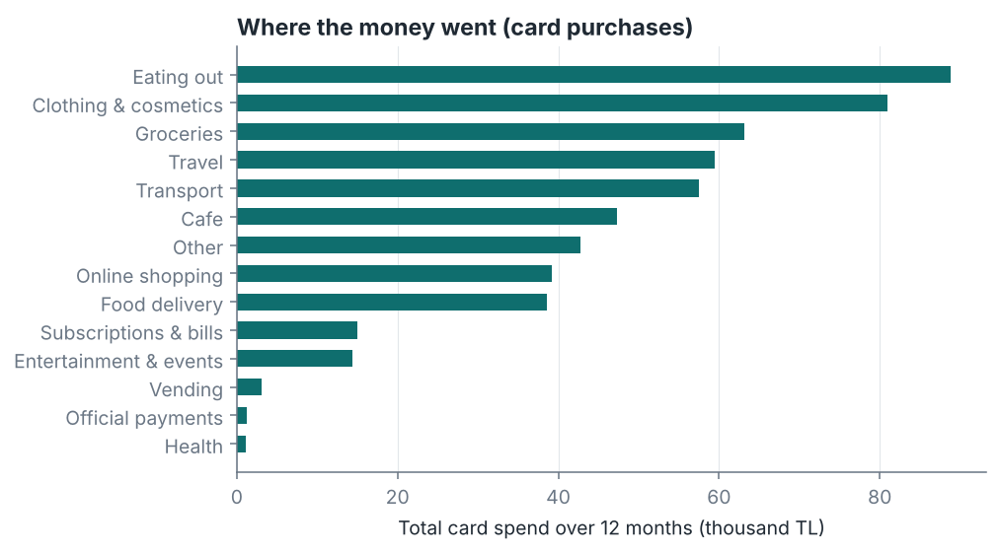
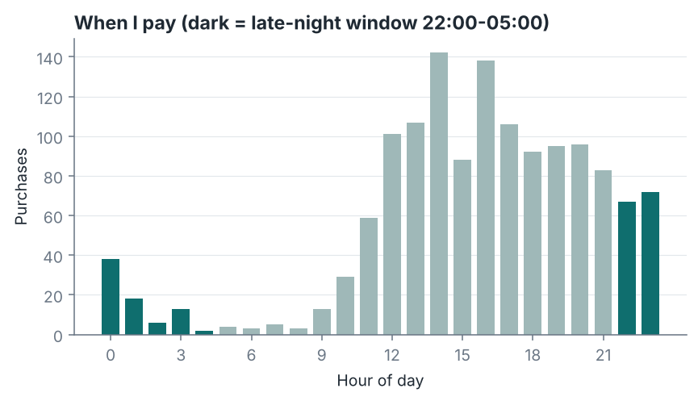
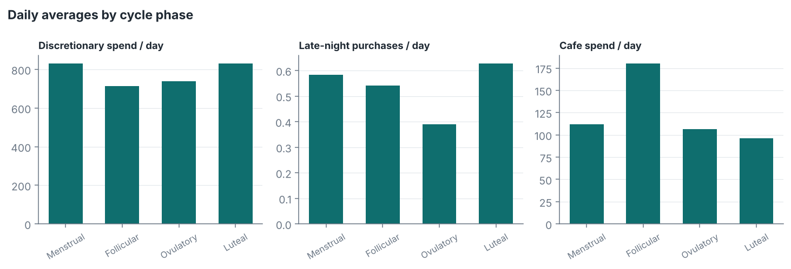
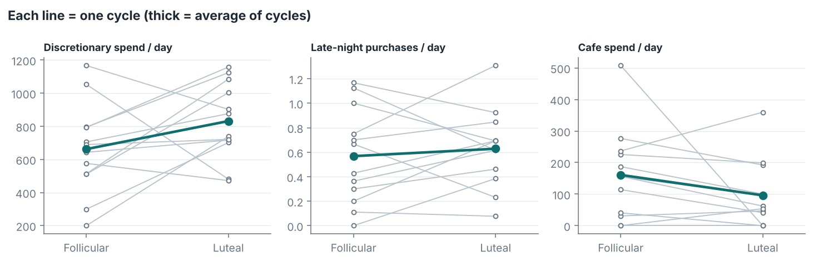
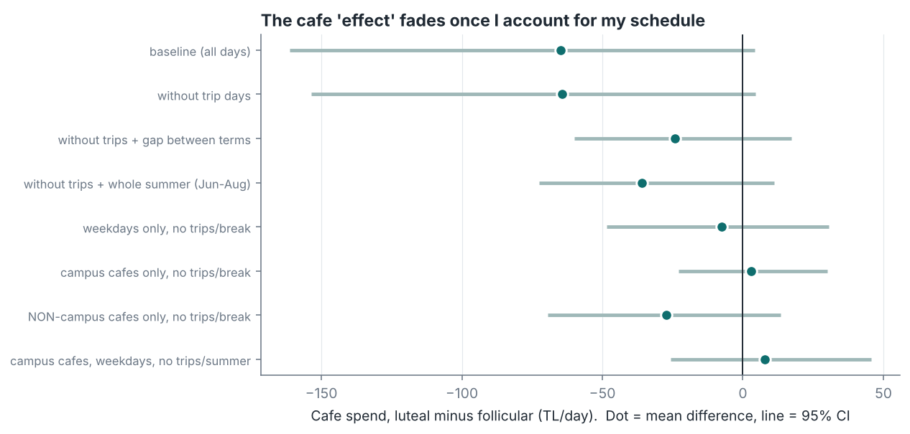
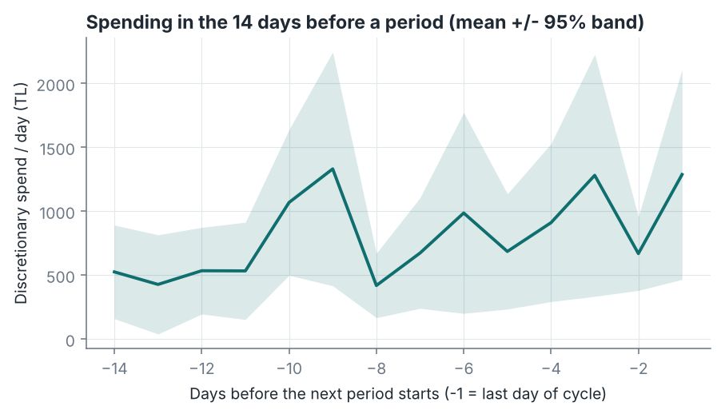

# Does my spending follow my menstrual cycle?

DSA210 course project. Personal data only: 12 months of my own bank data (23 Nov 2025 - 23 Nov 2026).

**Short version:** I checked whether I spend differently in different phases of my cycle. For
overall spending, late-night buying and food delivery I found nothing reliable. For a while it
looked like I buy less coffee in the luteal phase, but when I tried to break this result it
disappeared. It came from my calendar (a break between terms and a few unusual days), not from my cycle.

## Why I did this
I wanted to understand my own impulses better. Do I really spend differently at certain times,
or does it only feel that way? I have a year of bank data and a period-tracking app, so I could
test it instead of guessing.

## Question and hypotheses
Do my spending habits change across the phases of my cycle? I looked at how much I spend on
non-essential things, when I pay (late at night), and two habits: food delivery and cafes.

- **H1:** I spend more per day on non-essential things in the luteal phase than in the follicular phase.
- **H2:** I make more late-night purchases (22:00-05:00) in the luteal phase.
- **H3 (exploratory):** food delivery and cafe spending differ between the two phases.

I decided H1 and H2 before looking at any results. H3 came after I saw the data, so I treat it as exploratory.

## Data
| Source | What | Size |
|---|---|---|
| Akbank account export | date, time, amount, description | 2,060 rows, 12 months |
| Beije app | start and end of my cycles (Aug 2025 - Oct 2026) | 15 finished cycles + the current one |
| My own calendar | days abroad, break between terms | a few dates |

I only count the 1,380 **card purchases** as spending. Transfers between people, bank fees, cash
withdrawals and investments are left out. I sorted purchases into 14 categories with keyword rules
(`src/clean.py`). About 11% stay in "Other" (many small one-time merchants). For the unclear big
merchants I decided the category myself.

**Privacy:** the raw data is not in this repo (see `.gitignore`). The repo has the code, summary
tables and figures only. Anyone can run the code on their own bank export (see `data/raw/README.md`).

## Method
1. `src/clean.py` reads the bank file, separates purchases from other rows, assigns categories and removes all names.
2. `src/analyze.py` gives each day a cycle phase, builds daily numbers, runs the tests and makes the figures.
3. `src/robustness.py` tests the cafe result again in 11 different ways.

**Phases.** Menstrual = first 5 days (I did not record how long I bleed). I assumed ovulation is 14
days before the next period, so shorter and longer cycles are handled. Ovulatory = ovulation day
plus/minus 1 day, Follicular = the days between, Luteal = after that. These are estimates from the calendar, not measurements.

**Tests (luteal vs follicular).** Days next to each other are similar, so 348 days are not 348
independent data points. I compare cycle by cycle instead (12 cycles):
- average difference per cycle with a bootstrap 95% confidence interval, and a Wilcoxon signed-rank test;
- a *rotation test*: I slide the phase labels along the calendar and see how often a shifted
  version gives an effect as big as the real one. This keeps the structure of the data;
- very large single days (flights, tickets) are capped at the 99th percentile, and p-values are corrected for testing 6 measures (Holm);
- everything is repeated after removing slow seasonal changes (29-day moving average).

## Results
**At a glance**
- I spent **552,701 TL** on cards in 12 months. Eating out (16%) and clothing & cosmetics (15%) are the biggest categories.
- **H1 and H2: not supported.** No reliable difference between phases.
- **H3: not supported.** Food delivery shows nothing. Cafe spending first looked lower in the luteal phase, but not after I account for my schedule (below).




**H1 and H2.** On luteal days I spent more on non-essential things (831 vs 662 TL per day, higher in
9 of 12 cycles). But the 95% interval still includes zero (-31 to +347 TL), Wilcoxon p = 0.15 and
rotation p = 0.52. After removing seasonal changes the interval no longer includes zero (+16 to +347),
but the rotation test still gives p = 0.41. My two methods disagree, so I call H1 inconclusive.
Late-night purchases: 0.63 vs 0.57 per day (p between 0.4 and 0.6). Food delivery: no difference.




### The cafe result, and why I don't trust it
At first cafe spending was lower in the luteal phase (96 vs 161 TL per day, rotation p < 0.01).
About 74% of my cafe spending is on campus, so I suspected my schedule and tested it again:

| Scenario | Luteal minus follicular (TL/day) | 95% CI | Rotation p |
|---|---|---|---|
| 1. All days (original) | -65 | -161 to +4 | < 0.01 |
| 2. Without days abroad | -64 | -153 to +4 | < 0.01 |
| 3. Also without the break between terms (18 days) | -24 | -60 to +17 | 0.03 |
| 4. Without the whole summer | -36 | -72 to +11 | 0.10 |
| 5. Weekdays only | -7 | -49 to +31 | 0.31 |
| 6. Campus cafes only | +3 | -23 to +30 | 0.48 |
| 7. Non-campus cafes only | -27 | -69 to +13 | 0.24 |
| 8. Campus cafes, weekdays, term time | +8 | -26 to +46 | 0.91 |
| 9. Did I buy any coffee that day? (share of days, all days) | -0.11 | -0.24 to +0.01 | 0.02 |
| 10. Same, without days abroad and break | -0.06 | -0.18 to +0.04 | 0.05 |
| 11. Same, weekdays only | -0.03 | -0.17 to +0.10 | 0.32 |

The break between terms alone removes about 60% of the effect. One day in that break (a 2,000 TL cafe
day in June) falls in the follicular group. On weekdays, or with campus cafes only, the effect is gone.
What is left is a weak tendency to buy coffee on fewer days in the luteal phase (about 6 percentage
points, scenario 10). I would not call that a finding.



*How to read it: each dot is the average luteal-minus-follicular difference in cafe spending and the line is its 95% interval. If the line crosses 0 (black line), I can't rule out "no difference". The top two rows are the original result, each row below adds one correction.*



*Spending in the 14 days before a period. It is noisy and does not show a clear increase.*

| Table | File |
|---|---|
| Phase averages | `data/aggregated/phase_summary.csv` |
| Luteal vs follicular tests | `data/aggregated/luteal_vs_follicular_tests.csv` |
| Seasonal-change check | `data/aggregated/robustness_detrended.csv` |
| Cafe robustness (11 scenarios) | `data/aggregated/cafe_robustness.csv` |
| One row per cycle | `data/aggregated/cycle_level_means.csv` |

## Conclusion
| Hypothesis | What I found | Verdict |
|---|---|---|
| H1: more non-essential spending in the luteal phase | 831 vs 662 TL/day, higher in 9 of 12 cycles, but the interval includes 0 and my two tests disagree | Not supported (inconclusive) |
| H2: more late-night purchases in the luteal phase | 0.63 vs 0.57 per day, p = 0.4-0.6 | Not supported |
| H3: food delivery or cafe differ by phase | Delivery: no difference. Cafe: first lower in luteal, but it fades once I remove a few unusual days, the break and weekends | Not supported (fragile) |

In one year of my own data I found **no reliable sign that my spending follows my cycle**. The one
pattern that looked real came from my calendar, not from my cycle. For me, spending seems to depend
more on where I am and what my week looks like than on the phase I am in.

**What I learned**
- One "significant" result among many tests is only a lead. I believed it only after I tried to break it, and it broke.
- With repeated cycles, the real sample size is the number of cycles (12), not days (348).
- Real personal data is messy: transfers are not spending, merchant names need cleaning, and phases have to be estimated.

**What I would do next**
- Collect a second year of cycles and use ovulation tests instead of calendar estimates.
- Track screen time and mood every day from now on (an iPhone can't export it for past days), to study impulses and not only payments.
- Use itemised receipts (for example online orders) so I know what was actually bought.

## Limitations
- Small sample: 12 cycles, one person. Nothing here applies to other people.
- Many tests: 6 measures, then 11 cafe scenarios. One significant result among many means little, as the cafe case showed.
- Spending is mixed up with campus life (exams, holidays, weekends, trips). I removed what I could name, not what I forgot.
- Phase boundaries are estimated, and my cycles vary from 25 to 34 days, which blurs them.
- Bank data does not show what I bought. Cash and other cards are missing. "Non-essential" is my own category choice.
- My current cycle (started 28 Oct) is not finished. Only its first 9 days are labelled, and the last 18 days of data are not used.

## How to run
```bash
pip install -r requirements.txt
# put your own files in data/raw/ (see data/raw/README.md)
python src/clean.py
python src/analyze.py
python src/robustness.py
```
