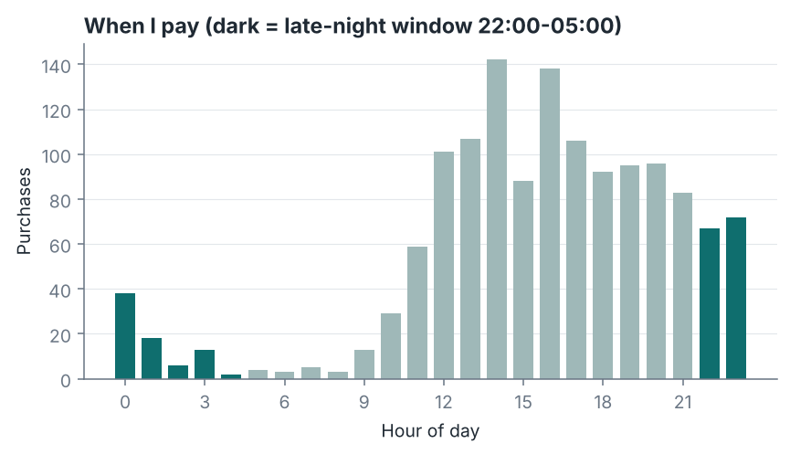
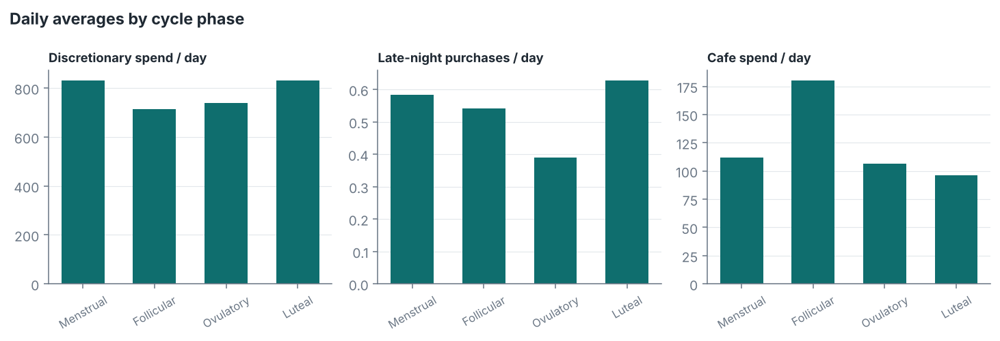

# Does my spending follow my cycle? A year of card data vs. menstrual-cycle phase

**DSA210 course project** · personal data only · 23 Nov 2025 – 23 Nov 2026

> **TL;DR** I tested whether my card spending changes across my menstrual cycle, using 12 months of
> bank data (1,380 card purchases) and 13 tracked cycles. **Overall spending, late-night buying and
> food delivery show no reliable cycle effect.** One early lead, "I buy less coffee in the luteal
> phase", looked convincing at first but **did not survive robustness checks**: it was driven by a
> few outlier days (one 2,000 TL day) and a break between terms. Showing that a tempting pattern
> is fragile is the main lesson of this project.

## Why this project
I wanted to learn more about my own impulses: do I really spend differently at certain times,
or does it only feel that way? A year of bank data plus a period-tracking app is a rare
chance to check this about myself instead of guessing.

## Question and hypotheses
Do my spending habits change across the phases of my menstrual cycle? I looked at
*how much* I spend on discretionary things, *when* I pay (late-night purchases), and
two specific habits: food delivery and cafe visits.

- H1: Discretionary spending per day is higher in the luteal phase than in the follicular phase.
- H2: Late-night (22:00-05:00) purchases are more frequent in the luteal phase.
- H3 (**exploratory**, added after seeing the data): cafe spending and food delivery differ between the two phases.

H1 and H2 were set before looking at results; H3 is exploratory and is treated that way.

## Data (all mine)
| Source | What | Size |
|---|---|---|
| Akbank account statement export | date, time, amount, description | 2,060 rows, 12 months |
| Beije period-tracking app | start/end of 15 finished cycles (Aug 2025 – Oct 2026) + the current one (started 28 Oct 2026) | 16 cycles |
| My own calendar | days abroad, gap between terms | a few dates |

Only the 1,380 **card purchases** are treated as consumption. Person-to-person transfers,
bank fees, cash withdrawals and investments are separated and excluded.
Purchases are assigned to 14 categories with transparent keyword rules (`src/clean.py`);
~11% of purchases (a long tail of one-off merchants) stay in "Other"; the ambiguous big ones were classified by hand.

> **Privacy:** raw and row-level data are never committed (`.gitignore`). The repository holds
> code, cycle-level/phase-level summary tables and figures only. Anyone can re-run the
> pipeline on their own export (see `data/raw/README.md`).

## Method
1. `src/clean.py`: parse export, classify rows, categorise purchases, drop all person names.
2. `src/analyze.py`: label each of 348 days with a cycle phase, build daily metrics, test, plot.
3. `src/robustness.py`: re-test the cafe result under 11 alternative definitions.

**Phases.** Menstrual = first 5 days (bleeding length was not recorded), ovulation assumed
14 days before the next period (so cycle-length differences are respected), Ovulatory =
ovulation day ±1, Follicular = between, Luteal = after. These are *calendar estimates*, not
hormone measurements.

**Tests (luteal vs follicular).** Days are strongly autocorrelated, so I do not treat 348 days as 348 independent
observations. Instead:
- *Cycle-level paired comparison* (n = 12 cycles): mean difference, bootstrap 95% CI, Wilcoxon signed-rank.
- *Rotation permutation test*: phase labels are circularly shifted along the calendar, which keeps their structure
  and the data's autocorrelation intact; p = share of shifts with an effect at least as large.
- Heavy tails winsorised at the 99th percentile (one-off flights, tickets); Holm correction across the 6 metrics.
- Repeated after removing slow seasonal drift (29-day rolling mean).

## Results



**H1 and H2 are not supported.** Luteal days had higher average discretionary spend
(831 vs 662 TL/day; higher in 9 of 12 cycles) but the evidence is weak: the cycle-level 95% CI just includes zero (-31 to +347 TL),
Wilcoxon p = 0.15, rotation p = 0.52. After removing seasonal drift the CI excludes zero (+16 to +347) but the rotation test still
says p = 0.41, so the two approaches disagree and I treat H1 as inconclusive. Late-night purchases: 0.63 vs 0.57 per day (p ≈ 0.4-0.6). Food delivery: no difference.




### The cafe lead, and why I do not trust it
At first, cafe spending was lower in the luteal phase (96 vs 161 TL/day; rotation p < 0.01).
Because 74% of my cafe spend is on campus, I suspected my schedule, so I re-tested it:

| Scenario | Luteal − follicular (TL/day) | 95% CI | Rotation p |
|---|---|---|---|
| 1. All days (original) | -65 | -161 to +4 | < 0.01 |
| 2. Without days abroad | -64 | -153 to +4 | < 0.01 |
| 3. Also without the gap between terms (18 days) | -24 | -60 to +17 | 0.03 |
| 4. Without the whole summer | -36 | -72 to +11 | 0.10 |
| 5. Weekdays only | -7 | -49 to +31 | 0.31 |
| 6. Campus cafes only | +3 | -23 to +30 | 0.48 |
| 7. Non-campus cafes only | -27 | -69 to +13 | 0.24 |
| 8. Campus cafes, weekdays, term time | +8 | -26 to +46 | 0.91 |
| 9. *Did I buy any coffee that day?* (share of days, all days) | -0.11 | -0.24 to +0.01 | 0.02 |
| 10. Same, without days abroad / break | -0.06 | -0.18 to +0.04 | 0.05 |
| 11. Same, weekdays only | -0.03 | -0.17 to +0.10 | 0.32 |

**What happened:** the gap between terms alone removes about 60% of the effect, and one single day
(a 2,000 TL cafe day in June, during that gap) sits in the follicular group. On weekdays and for
campus cafes the effect disappears. The only thing that remains is a weak, borderline tendency to
buy coffee on *fewer days* in the luteal phase (about 6 percentage points, scenario 10), which I
would not call a finding. The honest conclusion: **no robust cycle effect on spending in my data.**


| Table | File |
|---|---|
| Phase means | `data/aggregated/phase_summary.csv` |
| Luteal vs follicular tests | `data/aggregated/luteal_vs_follicular_tests.csv` |
| Detrended robustness | `data/aggregated/robustness_detrended.csv` |
| Cafe robustness (11 scenarios) | `data/aggregated/cafe_robustness.csv` |
| One row per cycle | `data/aggregated/cycle_level_means.csv` |

## Honest limitations
- **Small n:** 12 cycles, one person. Nothing here generalises.
- **Many looks:** 6 metrics, then 11 cafe scenarios. A single significant p-value among many tests means little, which is exactly what the cafe case showed.
- **Spending is confounded with campus life** (exams, holidays, weekends, trips); I removed what I could name, not what I forgot.
- Phase boundaries are estimated from calendar dates, not measured; cycle irregularity (25-34 days) blurs them.
- Account statements do not show what was bought, and cash / other cards are missing; "discretionary" is my own category choice.
- The current cycle (started 28 Oct) is unfinished, so only its days 1-9 (menstrual + early follicular, phase-certain for any cycle length) are labelled; the last 18 days of data are excluded.

## Reproduce
```bash
pip install -r requirements.txt
# put your own files in data/raw/ (see data/raw/README.md)
python src/clean.py
python src/analyze.py
python src/robustness.py
```
