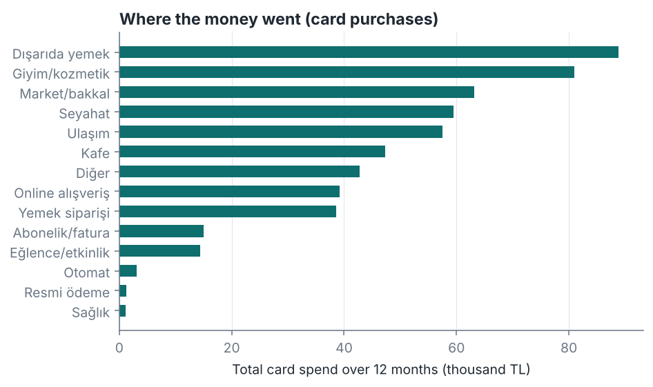
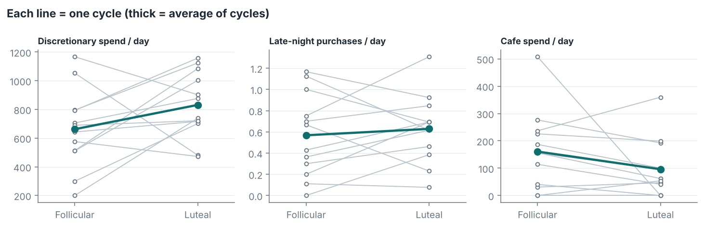
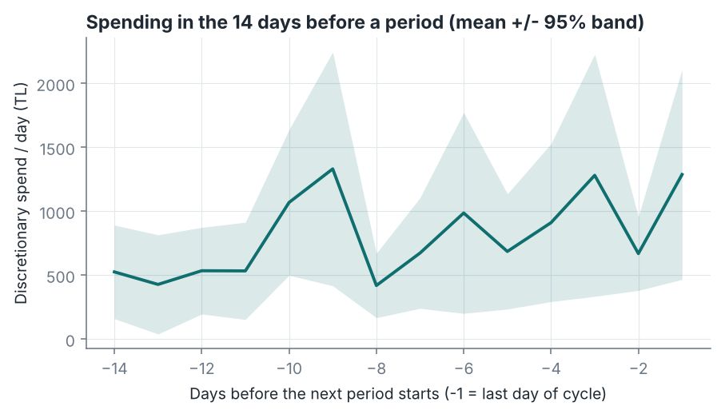

# Does my spending follow my cycle? A year of card data vs. menstrual-cycle phase

**DSA210 course project** · personal data only · 23 Nov 2025 – 23 Nov 2026

## Question
Do my spending habits change across the phases of my menstrual cycle? I looked at
*how much* I spend on discretionary things, *when* I pay (late-night purchases), and
two specific habits: food delivery and cafe visits.

**Hypotheses (written before running the tests)**
- H1: Discretionary spending per day is higher in the luteal phase than in the follicular phase.
- H2: Late-night (22:00-05:00) purchases are more frequent in the luteal phase.
- H3 (exploratory): food-delivery orders and cafe spending differ between the two phases.

## Data (all mine)
| Source | What | Size |
|---|---|---|
| Akbank account statement export | date, time, amount, description | 2,060 rows, 12 months |
| Beije period-tracking app | start/end of 15 finished cycles (Aug 2025 – Oct 2026) + the current one (started 28 Oct 2026) | 16 cycles |

Only the 1,380 **card purchases** are treated as consumption. Person-to-person transfers,
bank fees, cash withdrawals and investments are separated and excluded.
Purchases are assigned to 11 categories with transparent keyword rules (`src/clean.py`);
~11% of purchases (a long tail of one-off merchants) stay in "Other"; the ambiguous big ones were classified by hand.

> **Privacy:** raw and row-level data are never committed (`.gitignore`). The repository holds
> code, cycle-level/phase-level summary tables and figures only. Anyone can re-run the
> pipeline on their own export (see `data/raw/README.md`).

## Method
1. `src/clean.py`: parse export, classify rows, categorise purchases, drop all person names.
2. `src/analyze.py`: label each of 348 days with a cycle phase, build daily metrics, test, plot.

**Phases.** Menstrual = first 5 days (bleeding length was not recorded), ovulation assumed
14 days before the next period (so cycle-length differences are respected), Ovulatory =
ovulation day ±1, Follicular = between, Luteal = after. These are *calendar estimates*, not
hormone measurements.

**Tests (luteal vs follicular).** Days are strongly autocorrelated, so I do not treat 348 days as 348 independent
observations. Instead:
- *Cycle-level paired comparison* (n = 12 cycles): mean difference, bootstrap 95% CI, Wilcoxon signed-rank.
- *Rotation permutation test*: phase labels are circularly shifted along the calendar, which keeps their structure
  and the data's autocorrelation intact; p = share of shifts with an effect at least as large.
- Holm correction across the 6 metrics; heavy tails winsorised at the 99th percentile (one-off flights, tickets).
- *Robustness*: repeat everything after removing slow drift (29-day rolling mean), because spending
  is seasonal (campus semester vs. summer).

## Results



**Hypotheses H1, H2 are not supported.** Luteal days had higher average discretionary spend
(831 vs 662 TL/day; higher in 9 of 12 cycles) but the evidence is weak: the cycle-level 95% CI just includes zero (-31 to +347 TL),
Wilcoxon p = 0.15, rotation p = 0.52. After removing seasonal drift the CI excludes zero (+16 to +347) but the rotation test still
says p = 0.41, so the two approaches disagree and I treat H1 as inconclusive, not as confirmed. Late-night purchases: 0.63 vs 0.57 per day (p ≈ 0.4-0.6). Food delivery: no difference.




**One consistent signal (H3): cafe spending is lower in the luteal phase.**
Luteal 96 TL/day vs follicular 161 TL/day; lower in 9 of 12 cycles.
After removing seasonal drift the paired difference is -77 TL/day (95% CI -156 to -16),
rotation p < 0.01 (also after Holm correction across the 6 metrics), Wilcoxon p = 0.05-0.12 depending on detrending.



| Table | File |
|---|---|
| Phase means | `data/aggregated/phase_summary.csv` |
| Luteal vs follicular tests | `data/aggregated/luteal_vs_follicular_tests.csv` |
| Detrended robustness | `data/aggregated/robustness_detrended.csv` |
| One row per cycle | `data/aggregated/cycle_level_means.csv` |

## Honest limitations
- **Small n:** 12 cycles, one person. Nothing here generalises; the cafe result is a lead, not a finding.
- **Six metrics were tested**; the cafe result survives Holm correction, but it was one of several looks.
- **Cafe spending is confounded with campus life** (most cafe purchases are on campus): exams, holidays and
  my schedule change by week. Detrending helps but cannot remove this.
- Phase boundaries are estimated from calendar dates, not measured; cycle irregularity (25-34 days) blurs them.
- Account statements do not show what was bought, and cash / other cards are missing.
- The current cycle (started 28 Oct) is unfinished, so only its days 1-9 (menstrual + early follicular, phase-certain for any cycle length) are labelled; the last 18 days of data are excluded.

## Reproduce
```bash
pip install -r requirements.txt
# put your own files in data/raw/ (see data/raw/README.md)
python src/clean.py
python src/analyze.py
```
